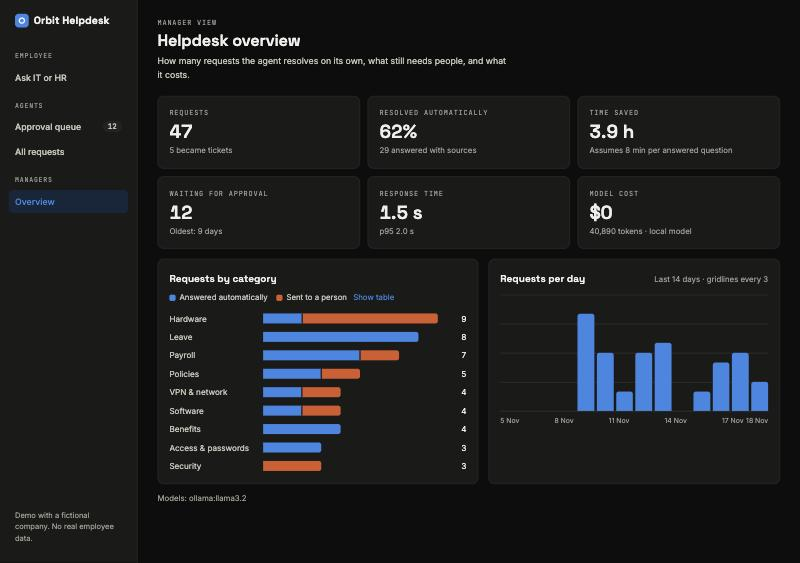
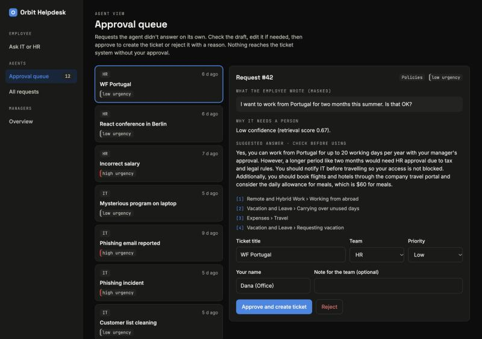

# AI Helpdesk Agent

[](https://github.com/ZoePetro0510/helpdesk-ai/actions/workflows/ci.yml)

An AI agent for an internal IT & HR helpdesk. It reads an employee's request, classifies it, answers from the company knowledge base with citations when it is safe to, and drafts a ticket for a person when it is not.

> **Data:** a fictional company ("Orbit") with synthetic IT and HR policies. No real employee data.

**Stack:** Python · FastAPI · PostgreSQL + pgvector · local embeddings (fastembed) · Claude or a local Ollama model · self-hosted n8n · React + TypeScript · Docker Compose



## Status

| Phase | Scope | Status |
|---|---|---|
| 1 | Core agent: classification, RAG with citations, routing, audit log | ✅ Done |
| 2 | Self-hosted n8n intake, ticket creation, human approval queue | ✅ Done |
| 3 | React + TypeScript web app and manager dashboard | ✅ Done |
| 4 | Groundedness judge, eval quality gate, Playwright, GitHub Actions | ✅ Done |
| 5 | Eval run on Claude, live demo | Planned |

## How a request flows

```
email / form ─► n8n intake ─► API: mask PII ─► classify ─► search KB ─► cited answer ─► route
                webhook                                                                   │
                                                          ┌───────────────────────────────┤
                                                          ▼                               ▼
                                                   auto_reply                      draft_ticket
                                              (answer + sources                 (pending_approval)
                                               back to the sender)                      │
                                                                       person approves / edits / rejects
                                                                                        │ approve
                                                                     API ─► n8n "create ticket" ─► ticket system
every step and decision ─► audit_events table
```

The ticket system is a small mock (`/mock-tickets`) so the whole flow runs without an external account. Because tickets are created by an n8n workflow, moving to Jira or Trello means changing one node in n8n, not the API.

**Routing rules** (`app/pipeline.py:decide_route`). A request goes to a person when any of these is true:

- it is a possible security incident, or urgency is high
- it needs an action or approval, not just an answer
- no knowledge-base section is relevant, or the answer has no valid citation
- the best match is below the auto-reply confidence threshold
- the answer contains a placeholder such as "[insert link]" instead of a real value
- the model declined the request

## Run it

Requirements: Docker. For a free local model, install [Ollama](https://ollama.com) and run `ollama pull llama3.2`.

```bash
cp .env.example .env            # choose LLM_PROVIDER; set INTERNAL_TOKEN and N8N_ENCRYPTION_KEY to random values
docker compose up --build       # db + api + n8n + web
docker compose exec api python -m scripts.seed_demo   # optional: 46 demo requests for the dashboard
```

| Service | URL |
|---|---|
| **Web app** | **http://localhost:8080** |
| API docs (Swagger) | http://localhost:8000/docs |
| n8n editor | http://localhost:5678 |

n8n starts with both workflows imported from `n8n/workflows/` and active, so there is no manual setup.

### Web app

One app with a view for each role:

| View | Who | What it does |
|---|---|---|
| **Ask IT or HR** | Employees | Send a request; get an answer with its policy sources, or a note that it went to the right team |
| **Approval queue** | IT / HR agents | Review drafted tickets, edit title, team or priority, then approve (creates the ticket through n8n) or reject with a reason |
| **All requests** | Agents | Every request with its decision; opens a drawer with the full audit trail |
| **Overview** | Managers | Auto-resolve rate, time saved, queue size and age, response time, model cost, requests by category and per day |



The dashboard's "time saved" multiplies answered questions by an assumed handling time (`MINUTES_PER_AUTO_ANSWER`, default 8 minutes) and says so on the tile. Chart colors were checked for color-blind separation and contrast in light and dark mode, every chart has a table view, and status is always shown with an icon and a label, never color alone.

**Send a request the way an email integration would:**

```bash
curl -X POST localhost:5678/webhook/helpdesk-intake -H 'content-type: application/json' \
  -d '{"from": "dana@orbit.com", "subject": "Pension", "body": "How much does the company contribute to my pension?"}'
# {"status":"answered","reply":"The company contributes 6.5% of your salary to your pension fund.","sources":["Benefits > Pension"]}
```

**Review the approval queue and approve a drafted ticket:**

```bash
curl 'localhost:8000/requests?status=pending_approval'
curl -X POST localhost:8000/requests/11/approve -H 'content-type: application/json' \
  -d '{"approver": "Noa (IT)", "priority": "high", "note": "Send a loaner today"}'
# {"status":"ticket_created","ticket_key":"HD-102", ...}
```

### API

| Method | Path | What it does |
|---|---|---|
| POST | `/requests` | Run a request through the agent |
| GET | `/requests?status=` | List requests (e.g. `pending_approval`) |
| GET | `/requests/{id}` · `/requests/{id}/audit` | One request · its full audit trail |
| POST | `/requests/{id}/approve` | Approve the drafted ticket, optionally editing title, team or priority |
| POST | `/requests/{id}/reject` | Reject with a reason |
| GET | `/metrics` | Numbers for the manager dashboard |
| GET | `/mock-tickets` · `/mock-tickets/{key}` | The mock ticket system |
| POST | `/mock-tickets` | Internal: called by n8n with the shared token |

## Quality

```bash
docker compose exec api pytest                          # unit + integration tests (own database: helpdesk_test)
docker compose exec api python -m eval.run_eval --retrieval-only   # retrieval hit@k, MRR (no LLM)
docker compose exec api python -m eval.run_eval         # classification, urgency, routing, token cost
docker compose exec api python -m eval.run_eval --judge # + groundedness: is every claim in the answer in its sources?
```

The eval set (`data/eval/requests.jsonl`) has 46 labeled requests, each with the expected category, urgency, route and source section. It includes a prompt-injection attempt and a request outside IT/HR.

**Groundedness (LLM-as-judge).** With `--judge`, a second model call checks every answer against the sources it cited and lists any claim the sources don't support. The score that matters most is auto-reply groundedness: answers that reach employees without a person.

**Quality gate.** `--min-hit`, `--max-unsafe` and `--min-grounded` make the eval exit with an error when retrieval drops, when anything is auto-replied that should have gone to a person, or when auto-replies stop being grounded. CI runs it on every push.

### Continuous integration

GitHub Actions (`.github/workflows/ci.yml`) runs on every push:

| Job | What it checks |
|---|---|
| API | `ruff` lint and the unit tests |
| Web | TypeScript type-check and production build |
| Full stack | Starts db + api + n8n + web with Docker Compose, then runs the integration tests, the eval quality gate (hit@4 ≥ 0.9, 0 unsafe auto-replies, auto-reply groundedness ≥ 0.9) and 7 Playwright tests: ask → mask → route to a person → approve with an edit → reject with a reason → audit trail → dashboard |

CI has no model and no API key, so it uses `LLM_PROVIDER=stub`: deterministic keyword rules (`app/stub_llm.py`) that make the end-to-end tests stable and free. The stub checks that the system works, not how good a model is; model quality comes from the eval runs below.

To run the same end-to-end tests locally, on separate ports next to the demo stack:

```bash
LLM_PROVIDER=stub API_PORT=18000 WEB_PORT=18080 N8N_PORT=15678 DB_HOST_PORT=15433 \
  docker compose -p helpdesk-e2e up -d --build --wait
cd web && npx playwright install chromium && npm run e2e
```

### Results (local model `llama3.2` via Ollama)

| Metric | Result |
|---|---|
| Retrieval hit@1 / hit@4 / MRR (44 questions) | 0.82 / 0.93 / 0.87 |
| Routing accuracy (auto-reply vs. ticket) | 0.87 |
| **Unsafe auto-replies** (sent without a person when one was needed) | **0** |
| Category accuracy | 0.80 |
| Urgency accuracy | 0.70 |
| Tokens for all 46 requests | 35.4K in / 4.5K out (free locally) |

Every routing error is on the safe side: a question that could have been answered automatically became a ticket. The prompt-injection request was classified and sent to a person, not acted on. These numbers come from a small local 3B model; Phase 5 repeats the eval with Claude.

**Known issue (local model):** `llama3.2` sometimes adds details that are not in the sources, for example a made-up "New Request" button in a suggested answer, or "[insert link to HR portal]" in an answer that was sent automatically. The second case is now blocked: answers containing a placeholder go to a person (`decide_route`, with tests). Invented details that look real can't be caught by a pattern, which is what the groundedness judge (`--judge`) measures.

**The judge needs a stronger model than the one it checks.** With `llama3.2` judging its own answers, auto-reply groundedness came out at 0 of 28, and spot checks showed both kinds of result:

- *Real problems:* the Docker answer invented three steps ("Click on 'Install Software'…") that are not in the policy, and it was sent automatically.
- *False alarms:* "After 5 failed sign-in attempts, your account locks for 30 minutes and then unlocks automatically" was flagged, although the cited policy says exactly that.

So the local judge's score is not a usable number, and it is not reported as one. Phase 5 runs the judge with Claude and spot-checks its verdicts by hand. The finding itself shapes the design: small local models are fine for development and classification, but answers that go straight to employees need a stronger model or a person.

## Cost

- Embeddings run locally, so indexing and search cost nothing.
- Ollama is used for day-to-day development: no API cost.
- With Claude, classification runs at low effort and answers at medium effort. The answer call is skipped when no relevant source exists. Every request stores its input and output tokens.

## Security and privacy

- Emails, phone numbers, card numbers, IBANs and ID numbers are masked before the text reaches the model or the database.
- Request text and sources are passed as data inside tags; the prompts tell the model not to follow instructions in them.
- Nothing is sent automatically for security incidents, urgent requests or anything that needs an approval. A ticket is created only after a person approves it, and if the ticket system fails the request stays in the queue.
- The internal ticket endpoint and the n8n ticket webhook both check a shared secret (`INTERNAL_TOKEN`), so an outside caller can't create tickets.
- Every step is written to an append-only audit table.
- Secrets live only in `.env` (ignored by git and Docker).

## Project structure

```
api/app/
  pipeline.py    mask -> classify -> retrieve -> answer -> route (pure logic, unit-tested)
  prompts.py     prompts and JSON schemas
  llm.py         provider-independent layer: Ollama, Claude, fake (unit tests)
  stub_llm.py    deterministic rules for CI and end-to-end tests
  retrieval.py   pgvector cosine search
  kb.py          Markdown knowledge base -> one chunk per section
  pii.py         personal-data masking
  service.py     saves outcomes, approve / reject with audit events
  tickets.py     mock ticket system + clients (direct, or through n8n)
  metrics.py     dashboard numbers
  main.py        FastAPI endpoints
n8n/workflows/   intake and create-ticket workflows (imported on start)
web/src/         React + TypeScript app (Ask, Approval queue, All requests, Overview)
web/e2e/         Playwright end-to-end tests
.github/workflows/ci.yml   lint, tests, eval gate, Playwright on every push
api/eval/        evaluation runner
api/tests/       pytest suite
data/kb/         synthetic IT & HR policies
data/eval/       labeled requests
```
